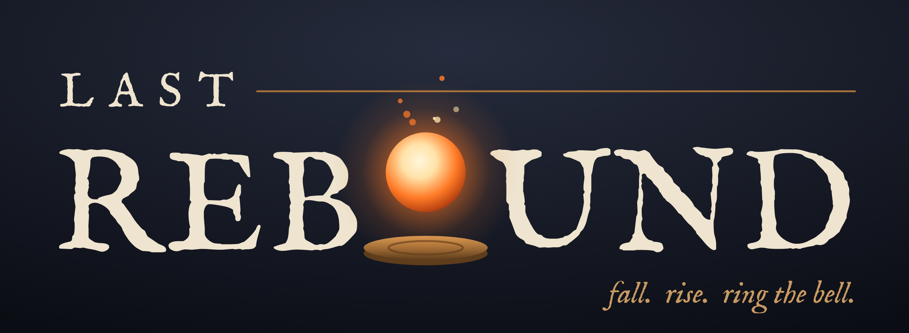
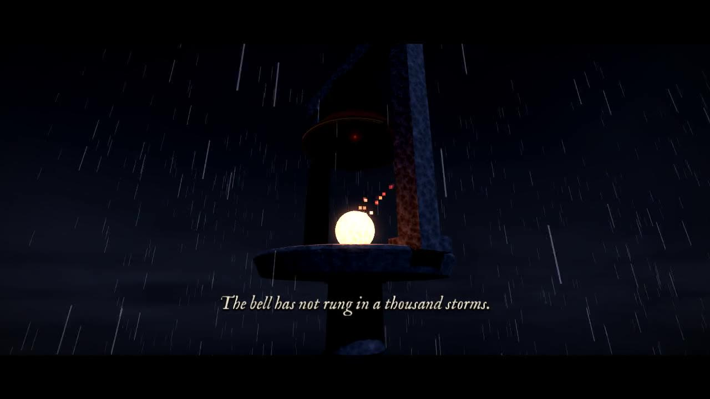
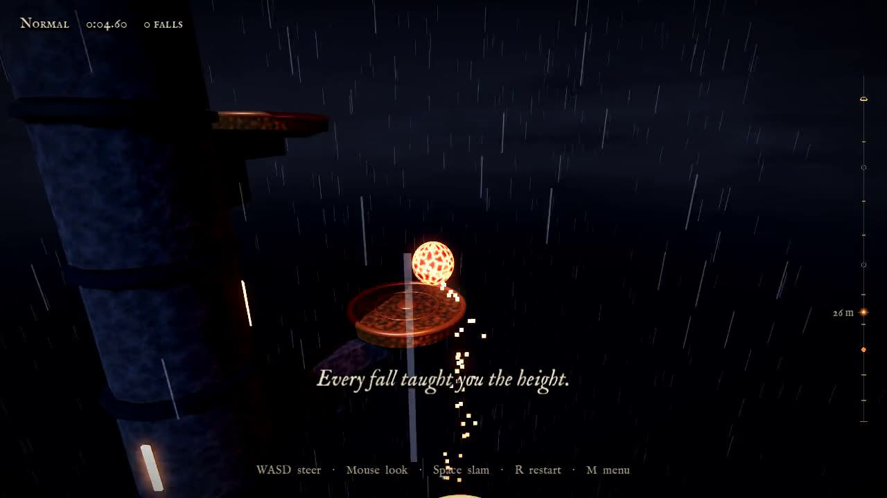
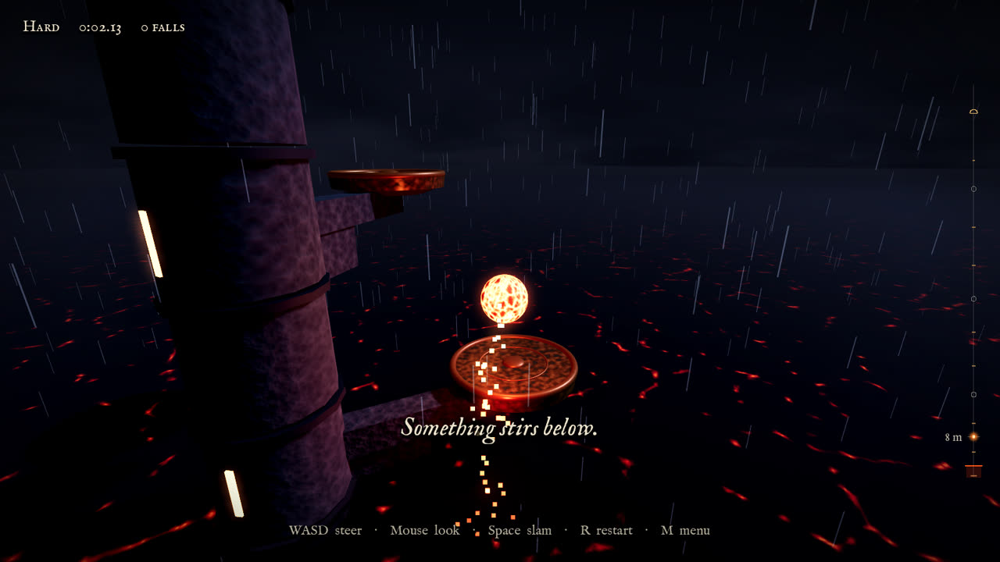
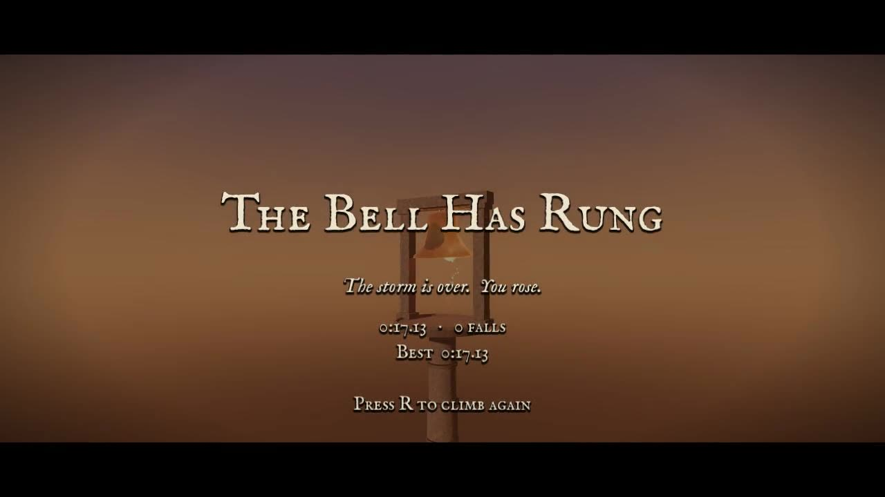
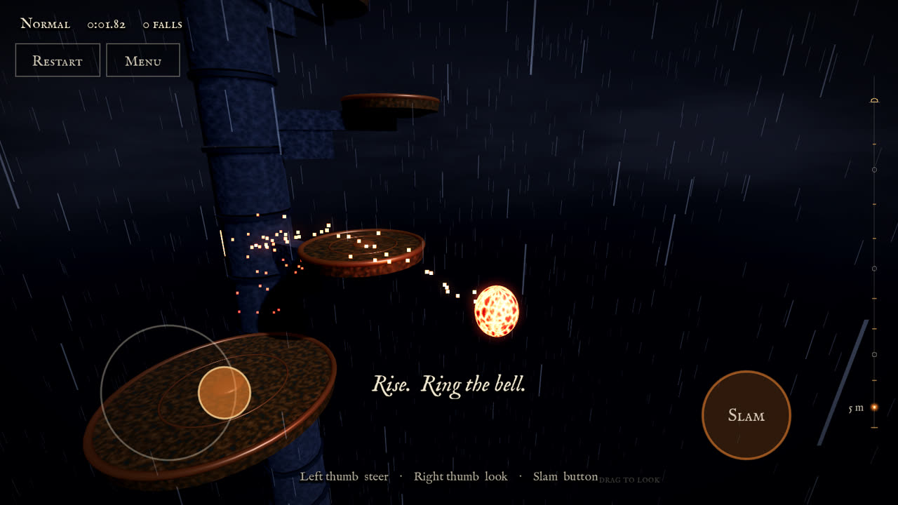

<p align="center"></p>

<p align="center"><i>A storm. A bell tower. One ember. Fall, rise, ring the bell.</i></p>

A 3D physics platformer made in **Godot 4.5**. You are a burning ember climbing a
stone bell tower in a thunderstorm. Every platform is a bronze gong that rings its
own note when you hit it, so **your climb plays the melody**.

<p align="center">
  
  
  
  
</p>

**Trailer (40 s, with sound):** [`media/trailer.mp4`](media/trailer.mp4)

## Download

Ready-to-play builds are in the [`downloads/`](downloads) folder. Click a file, then **Download raw file** (the ⤓ button):

| Platform | File |
| --- | --- |
| Android (7.0+, 64-bit) | [`LastRebound.apk`](downloads/LastRebound.apk) |
| Windows | [`LastRebound_Windows.zip`](downloads/LastRebound_Windows.zip) |
| macOS | [`LastRebound_macOS.zip`](downloads/LastRebound_macOS.zip) |
| Linux | [`LastRebound_Linux.zip`](downloads/LastRebound_Linux.zip) |

## Play

- **Windows:** unzip `LastRebound_Windows.zip` and run `LastRebound.exe`. The build
  is unsigned, so if SmartScreen warns you, click *More info → Run anyway*.
- **macOS:** unzip, run `xattr -cr LastRebound.app` in Terminal, then open the app.
- **Linux:** `chmod +x LastRebound.x86_64 && ./LastRebound.x86_64`
- **Android:** open the APK on your phone and allow installing from that source. Play
  Protect may warn about an unknown developer: tap *More details → Install anyway*.
- **Editor:** open `project.godot` in Godot 4.5+ and press F5.

| Control | Action |
| --- | --- |
| WASD / Arrows | Steer (camera-relative) |
| Mouse | Orbit the camera (look up at the next gong) |
| Space (in the air) | **Slam**: drive down hard; a slam landing launches 22% faster, which peaks about 49% higher |
| R | Restart at the same difficulty (skips the intro) |
| M | Back to the menu |
| Space / Enter during intro | Skip the intro |
| Esc | Release the mouse |

**On phones and tablets:** left thumb steers (a joystick appears under it), drag
on the right side to look, tap **Slam** in the air, and use **Restart / Menu** at
the top left.

<p align="center"></p>

## Modes

Pick a mode from the menu. **Easy, Normal and Hard** are the story: climb the
tower and ring the bell, with a best time for each. **Last Rebound** is endless.

### Story difficulties: the hazards change, not just the gong size

| | Easy | Normal | Hard |
| --- | --- | --- | --- |
| Gong size | 25% bigger, +1 m launch | as built | 18% smaller |
| Air control | 38 | 32 | 30 |
| Braziers (checkpoints) | 8 | 3 | **2** (37 m, 60 m) |
| **Swinging gongs** | none | 2, slow | **7**, faster and wider |
| **Cracked gongs** | none | none | **3**: hold one landing, crumble, reform 4 s later |
| **Wind gusts** | none | none | every 7 to 11 s, 13 N for 2.4 s |
| **The abyss** | none | none | rises at 0.8 m/s |
| Lightning | rare | normal | frequent |

- **Swinging gongs** sweep back and forth around the tower on their stone arms, so time your jump.
- **Cracked gongs** glow red through their fractures and show up red on the altitude rail.
- **Wind** shoves you sideways mid-air. The rain slants the way it's about to blow.
- **The abyss** is a churning floor of ember-cracked darkness that climbs behind you.
  Touch it and you drop back to your last brazier.

### Last Rebound: the endless tower

- The tower is **generated as you climb, forever**. The higher you go, the smaller the
  gongs, the wider the gaps, the more gongs swing or are cracked, the stronger and more
  frequent the gusts, and the faster the abyss rises (it speeds up to catch you if
  you get far ahead).
- **One life.** When the abyss takes you, the run ends.
- **XP:** +5 per new gong × a **combo** (up to ×5) that grows while you keep climbing
  and resets if you slip back down. Slam landings, braziers (every 10th gong) and every
  50 m add bonuses.
- **Levels and ranks** persist between runs: Ash, Cinder, Spark, Flame, Blaze, Inferno,
  Sunfire, The Last Rebound.
- **Ember colours unlock** as you level up: Frost (level 3), Venom (5), Amethyst (8),
  Sunfire (12). Pick yours on the menu.

Every number is in `scripts/difficulty.gd` (story) and `scripts/endless.gd` (endless).
You can skip the menu from the command line: `--path . -- --difficulty=hard`
(easy, normal, hard or last).

## The story beats

1. **The fall.** The ember rests beside the great bell at the top. Lightning
   strikes the bell and knocks it off. It falls the full 75 m of the tower, and
   every gong it passes rings. It slams into the bottom gong and the title hits.
2. **The climb.** Gongs launch you upward. Checkpoint braziers light as you pass.
   The score adds layers as you rise: the drums join at about 10 m and the
   strings at about 40 m.
3. **The collapse.** At the last checkpoint (60 m), lightning splits the tower.
   Everything below you crumbles into the abyss. There is no way back down.
4. **The dawn.** Touch the great bell. It rings, the storm breaks, the sun rises,
   and your time is saved as your best.

## How the physics works

- The ember is a real `RigidBody3D` (mass 1, continuous collision detection).
  Gravity, collisions, rolling and side hits are all handled by the physics engine.
- **Gongs add energy.** A real bounce can never take you higher than where you
  fell from. When the ember hits a gong's top face, the engine bounces it first,
  then the gong raises its upward speed to `sqrt(2·g·launch_height)`. Gongs never
  let you rest on them.
- The impact speed is taken from the ember's recent fall speed. At high speed,
  Godot's continuous collision detection can set the velocity to zero in the
  same step as the hit, so the current velocity can't be trusted there.
- Bounce combine: Godot adds the two materials' bounce values. Ember 0.45 + stone/bronze 0.40 = 0.85.
- Gravity is 14 m/s², which makes the ember feel heavy.

## Sound and music

Every sound is **synthesized from scratch** by `tools/make_audio.py` (numpy and
scipy). Nothing is sampled, so there are no licensing issues.

- Bells: modelled on real church-bell partials, including the minor-third
  "tierce" that makes bells sound mournful.
- Score: D minor at 80 BPM. Three synchronized stems (drone and choir; taiko
  and tower-clock ticks; strings and bell melody) mixed live by height.
- A D-major dawn finale, thunder, rain, wind that howls as you fall, the
  collapse, the brazier ignite, and the title impact.

To regenerate the audio:

```bash
pip install numpy scipy
python tools/make_audio.py
```

## Project map

| Path | What |
| --- | --- |
| `scripts/game_manager.gd` | The director: menu, intro, play, collapse, finale, best times |
| `scripts/difficulty.gd` | Story difficulty presets, XP levels, ranks, ember colours |
| `scripts/endless.gd` | The endless tower: generation, scaling difficulty, XP and combo |
| `scripts/abyss.gd` | The rising abyss (Hard and Last Rebound) |
| `scripts/player.gd` | The ember: physics, steering, slam, impacts |
| `scripts/platform.gd` | Gongs: launch, ring, wobble, swing, crack, stone arm, brazier, collapse |
| `scripts/spine.gd` | The stone tower, built from stacked drums that can fall |
| `scripts/great_bell.gd` | The belfry and the bell (lathe-generated mesh) |
| `scripts/storm.gd` | Rain, lightning bolts, sky flashes, wind gusts, the dawn |
| `scripts/audio_director.gd` | Adaptive music, ambience, sound effects, master limiter |
| `scripts/camera.gd` | Orbit camera that avoids stone; cinematic and orbit modes |
| `scripts/hud.gd` | Altitude rail, story text, title card, letterbox, flashes, difficulty menu |
| `scripts/touch_controls.gd` | Phone controls: floating joystick, look drag, slam, restart/menu |
| `materials/storm_sky.gdshader` | Storm clouds, lightning glow, dawn |
| `scenes/Tower.tscn` | The level: edit each gong's `diameter`, `kind`, `launch_height` and `note` |

## Building it yourself

- **Desktop:** Project → Export → Windows / macOS / Linux (export templates for 4.5.1 required).
- **Android:** install the Android SDK (platform-tools and build-tools), set its path in
  Editor Settings → Export → Android, create your own release keystore, and export with the
  **Android** preset. Signing keys are deliberately not in this repo.

## Credits

Fonts: IM FELL English and IM FELL English SC by Igino Marini (SIL Open Font
License; see `assets/fonts/FONTS_LICENSE.txt`). Everything else (code, audio,
textures and meshes) is generated procedurally in this project.
